<p align="center">
  
</p>

<h1 align="center">Librarian</h1>

<p align="center">
  A calm, offline e-book reader for Android, part of the Oxygen Theme family.<br>
  EPUB, FB2 and TXT. No account, no cloud, no tracking: your books stay on your phone.
</p>

<p align="center">
  <picture>
    <source media="(prefers-color-scheme: dark)" srcset="docs/banner-dark.png">
    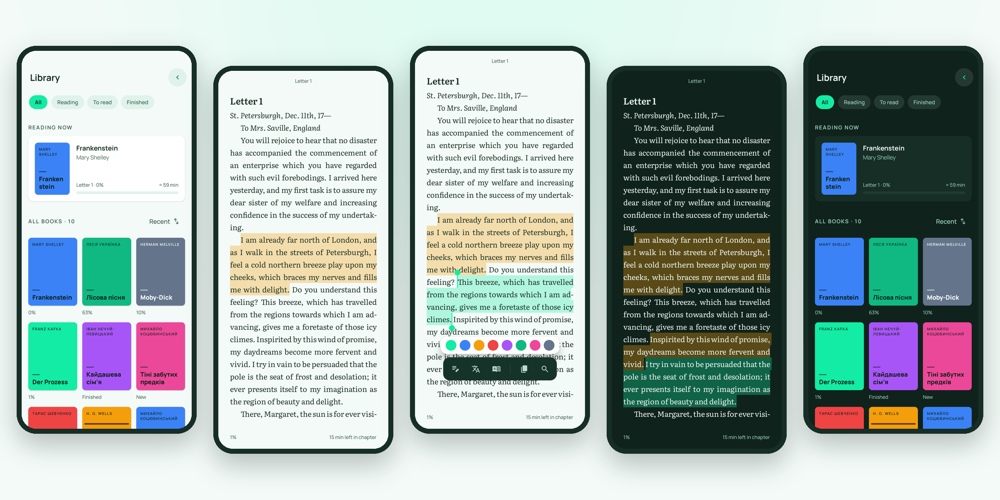
  </picture>
</p>

**Version:** L 1 · **Android:** 8.0+ (API 26) · **Languages:** English, Ukrainian · **License:** MPL 2.0

---

## Why Librarian

- **One place: your library.** There is no bottom bar and no floating button. Search, Highlights, Add Book and Settings sit in one menu behind the arrow in the top-right corner.
- **Reading without chrome.** The page is all text. Tap the centre to bring up the controls; they hide again after five seconds.
- **Colour belongs to the content.** Books without a cover get one drawn from eight Oxygen `mark-*` colours, and the same eight colours are used for highlights.
- **Quiet, quick motion.** Nothing bounces or loops, and nothing moves while you read. When Android's *Remove animations* setting is on, everything becomes a simple fade and pages turn instantly.

## Features

### Library
- Shelves: **All · Reading · To read · Finished**
- A **Reading now** card with chapter, progress and an estimate of the reading time left
- Sorting by recent, title or author, and search by title or author
- Long-press a book to mark it finished or unfinished, or remove it from the library
- Open EPUB and FB2 files straight from a file manager or chat app (*Open with → Librarian*)

### Reading
- **Pages** that follow your finger, or a continuous **Scroll** mode
- Justified text with real hyphenation in the book's language: English, Ukrainian, German and others
- **Contents**, **Bookmarks**, **Search in book** and a position slider (*p. 14 of 286 · 38%*)
- The **Text** sheet: font size; Literata, Manrope, Atkinson Hyperlegible or the system font; line spacing; light or dark page; pages or scroll; hyphenation
- The page theme can differ from the app theme, for example a dark page inside a light app
- Your place is saved on every page turn, and *minutes left in chapter* is shown at the bottom of the page

### Highlights and notes
- Press and hold a sentence to select it, then drag the handles to adjust the selection word by word
- Eight highlight colours, plus a note for any passage
- **Translate**, **Dictionary**, **Copy** and **Find in book**, all handed off to apps already on your phone
- A **Highlights** screen across all books, filtered by book or by *with notes* and exportable as Markdown through the share sheet

### Settings
- Theme: **Light** (default), **Dark** or **System**
- Interface language: **English** or **Українська**, switched in the app without changing the phone's language
- A page-turn animation switch: turn it off on e-ink screens

## Screenshots

| Library | Actions menu | Reading | Controls |
|:-:|:-:|:-:|:-:|
|  | 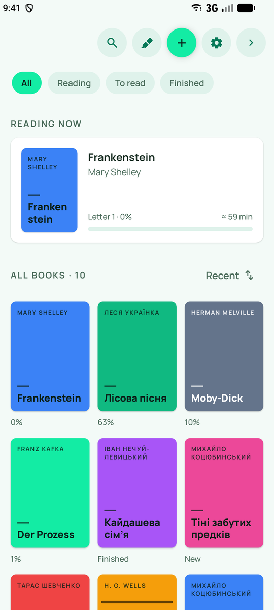 | 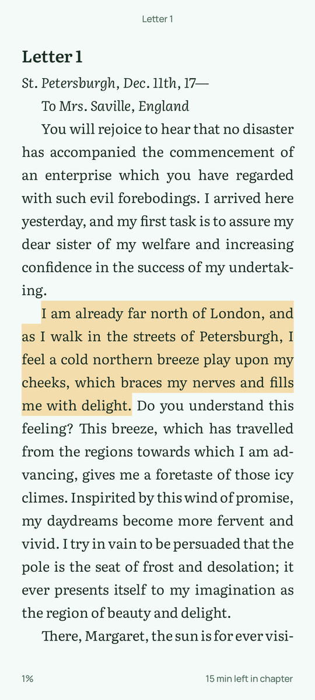 | 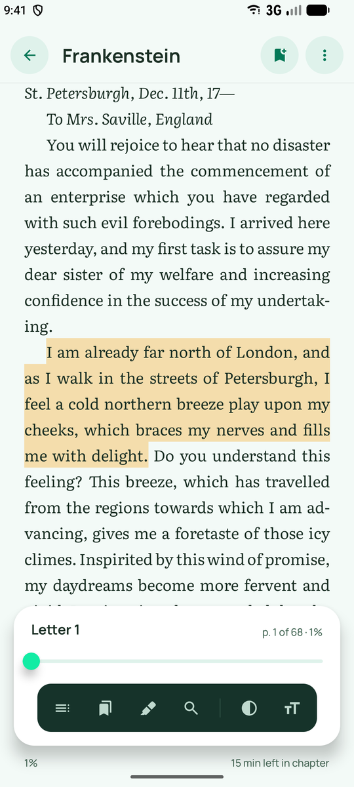 |
| **Text settings** | **Selection** | **Highlights** | **Settings** |
| 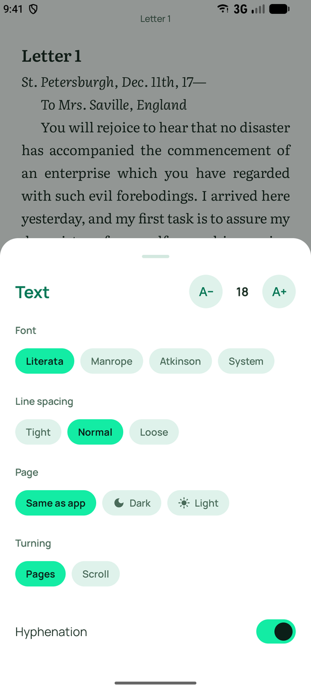 | 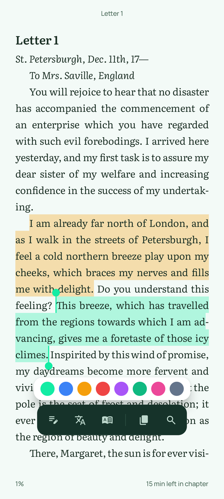 | 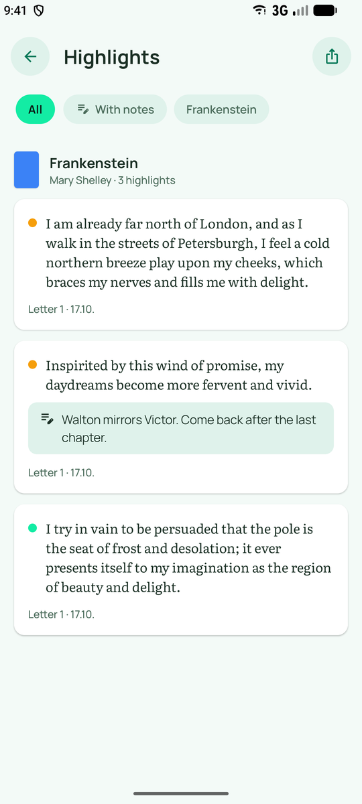 | 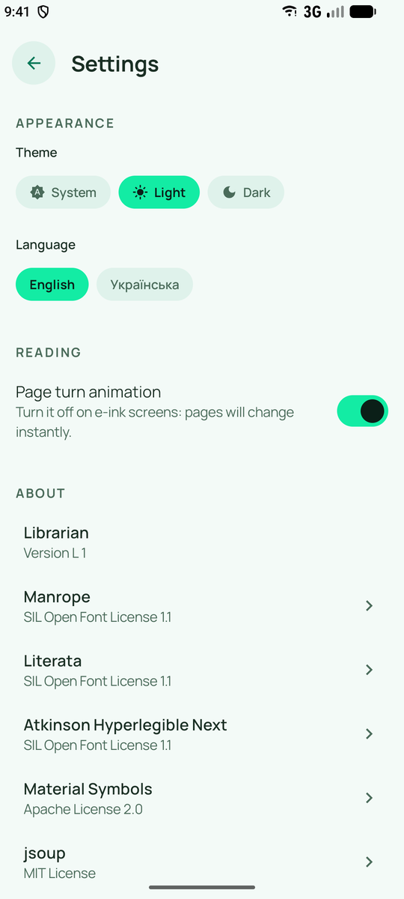 |

<details>
<summary><b>Dark theme</b></summary>

| Library | Reading | Selection | Controls |
|:-:|:-:|:-:|:-:|
| 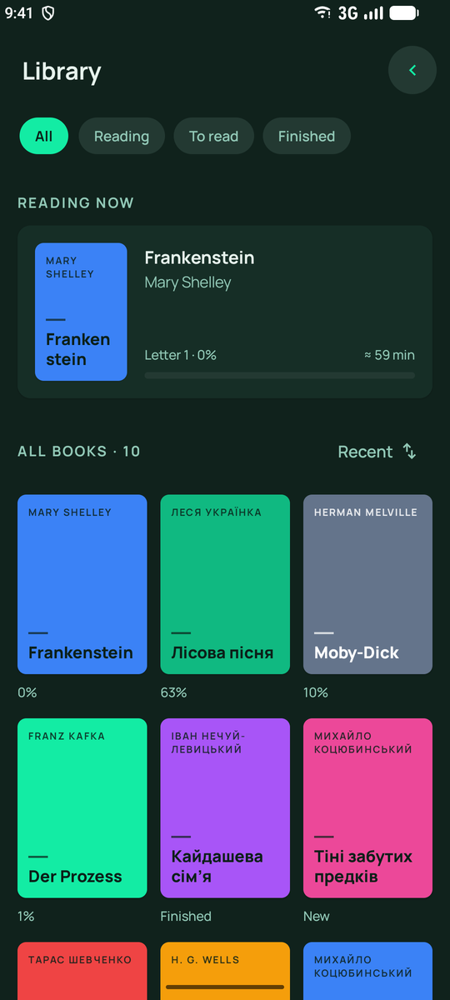 | 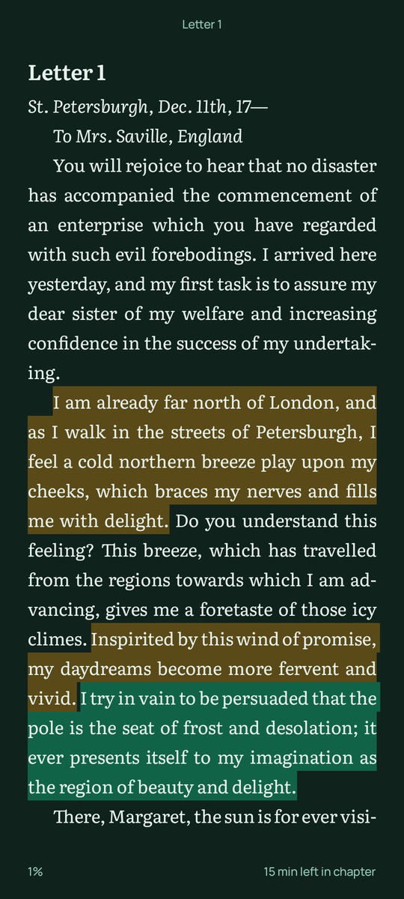 | 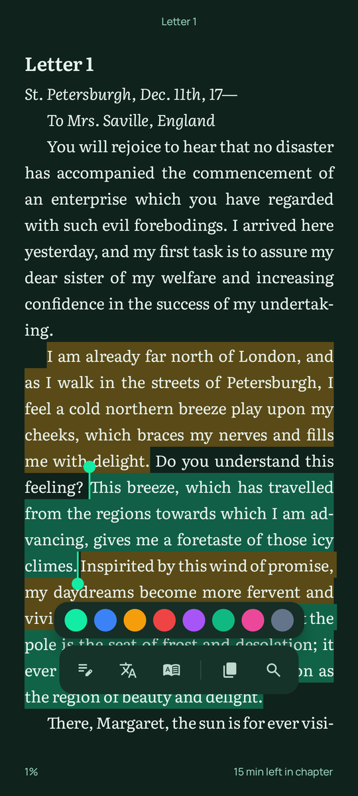 | 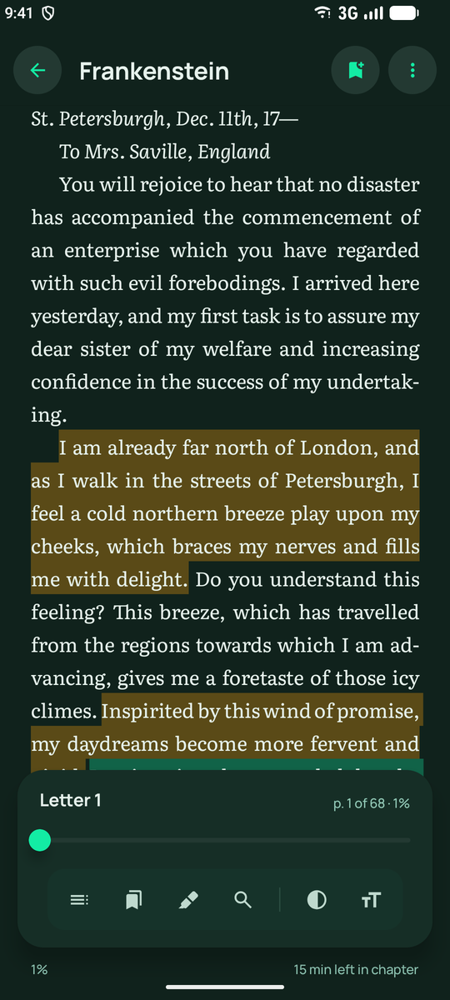 |
| **Text settings** | **Highlights** | **Actions menu** | **Settings** |
| 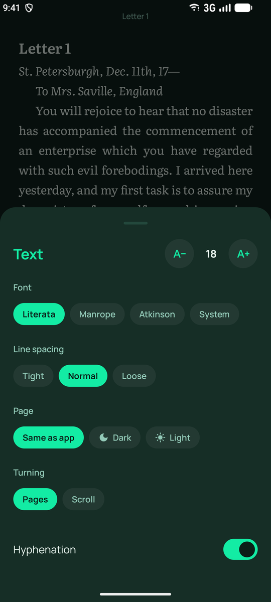 | 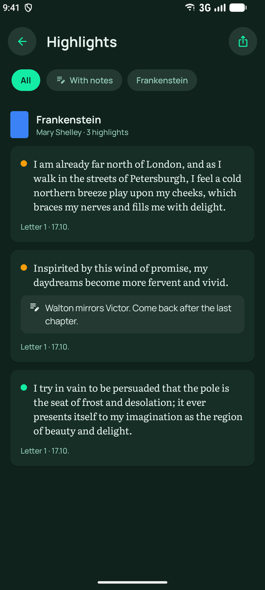 | 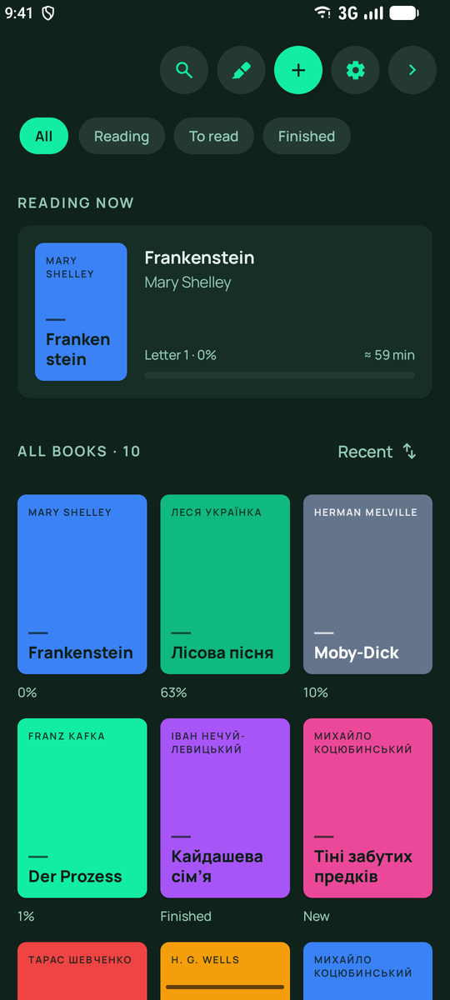 | 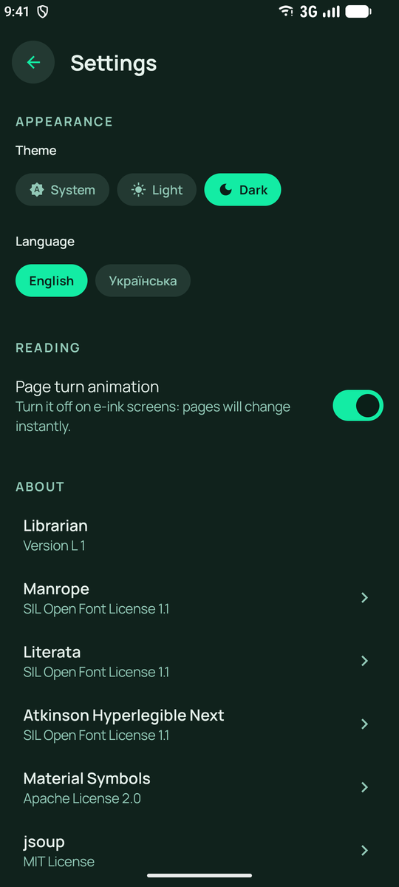 |

</details>

<details>
<summary><b>Українською</b></summary>

| Бібліотека | Читання |
|:-:|:-:|
| 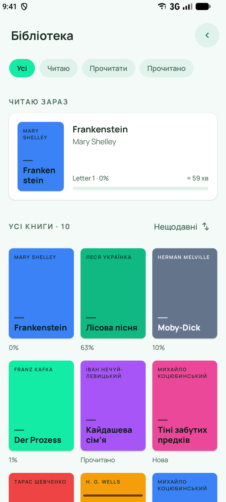 | 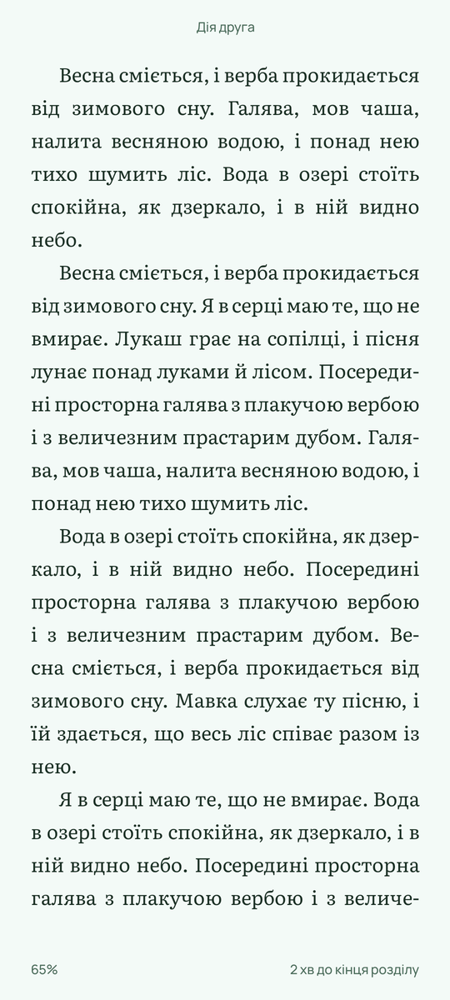 |

</details>

## Supported formats

| Format | What is read |
|---|---|
| **EPUB 2 / 3** | Text, chapter titles from the table of contents (`nav` or NCX), cover, title, author and language |
| **FB2**, **FB2.ZIP** | Sections, titles, epigraphs, poems, cover, title, author and language |
| **TXT** | UTF-8, UTF-16 or Windows-1251, detected automatically; chapters found from lines like *Chapter 5* or *Розділ 5* |

A book is copied into the app when you add it, so it keeps working if the original file is moved or deleted. The same file added twice is recognised and not duplicated. Images inside books are not shown: Librarian is built for reading text.

## Install

Download `releases/Librarian_L1.apk`, open it on your phone and allow installing from this source when Android asks.

## Build from source

You need JDK 17 or newer and the Android SDK (platform 36).

```bash
./gradlew :app:assembleDebug
```

The APK is written to `app/build/outputs/apk/debug/app-debug.apk`.

```bash
./gradlew :app:testDebugUnitTest
```

Unit tests cover the EPUB, FB2 and TXT parsers, sentence selection, search, reading progress and library sorting.

## Under the hood

- **Kotlin**, **Jetpack Compose** and **Material 3**, themed with Oxygen Theme tokens. Dynamic colour is off on purpose.
- **Room** for books, bookmarks and highlights; **DataStore** for settings; **Hilt** for dependency injection
- **jsoup** for reading EPUB XHTML and FB2
- **The page engine:** each chapter is laid out once as a single text layout, and a page is a window onto it. A paragraph that continues on the next page keeps the same line breaks and justification. Highlights and selection handles are drawn with justification-aware geometry. Positions are stored as *chapter + character offset*, not page numbers, so your place survives font and size changes.
- **AppCompat per-app languages:** the language choice is stored by the system on Android 13+, and by AppCompat on older versions.

```
app/src/main/java/com/oxygen/librarian/
├── book/        EPUB, FB2 and TXT parsers and the text model
├── core/        reading progress, sentence and word boundaries, search, shelves
├── data/        Room database, DataStore settings, book files and covers
├── feature/
│   ├── library/     library screen and actions menu
│   ├── reader/      page engine, paged and scroll readers, sheets, selection
│   ├── highlights/  highlights across all books, Markdown export
│   └── settings/    theme, language, licences
├── navigation/
└── ui/          Oxygen components and theme tokens
```

## Translations

The interface strings are in `app/src/main/res/values/strings.xml` (English) and `values-uk/strings.xml` (Ukrainian). To add a language, copy the file into `values-<code>/`, translate it, and add the code to `APP_LANGUAGES` in `SettingsScreen.kt` and to `localeFilters` in `app/build.gradle.kts`.

## License

Librarian is released under the [Mozilla Public License 2.0](LICENSE). You can use, modify and ship it, including inside larger projects; changes to Librarian's own files must stay open under the same license.

## Third-party

| | License |
|---|---|
| [Manrope](https://github.com/sharanda/manrope), [Literata](https://github.com/googlefonts/literata), [Atkinson Hyperlegible Next](https://www.brailleinstitute.org/freefont/) | SIL Open Font License 1.1 |
| [Material Symbols](https://github.com/google/material-design-icons) | Apache License 2.0 |
| [jsoup](https://jsoup.org) | MIT |

The full license texts ship with the app under **Settings → About**.
